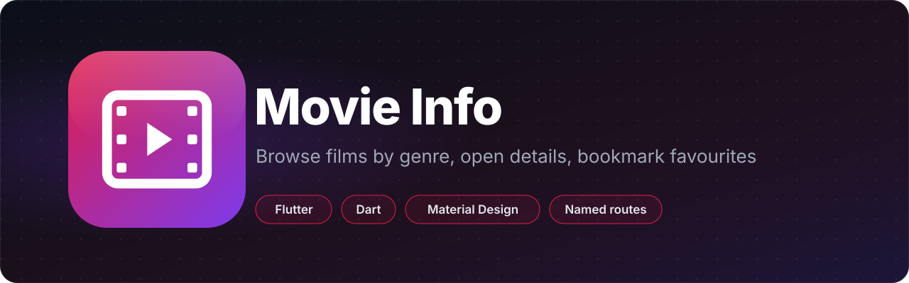
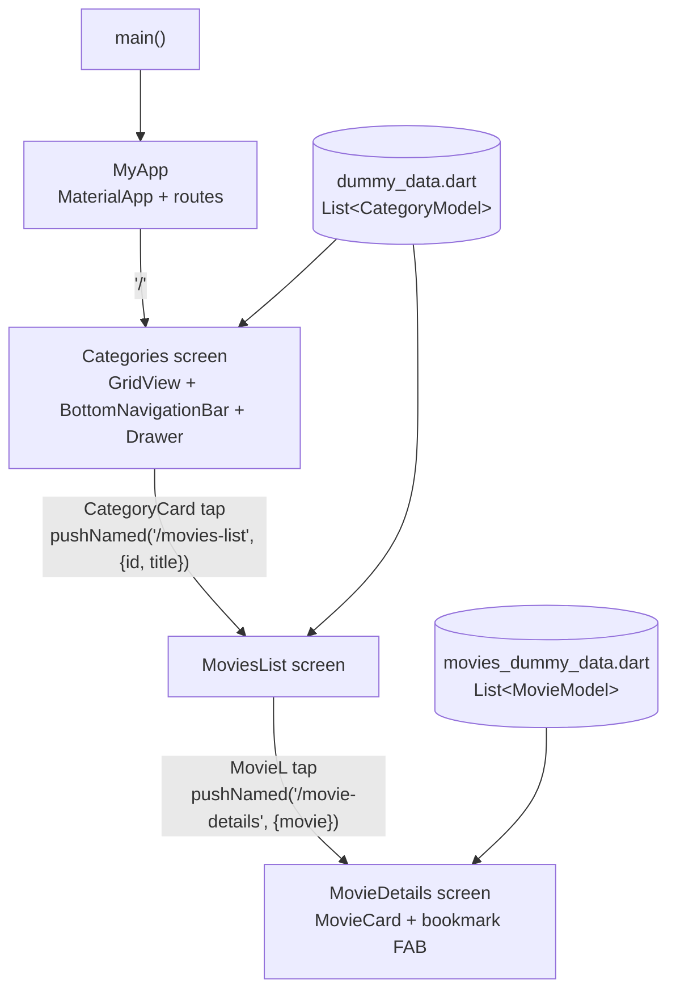

<div align="center">
  
  <p><b>A Flutter movie catalogue that lets you browse films by genre, open a detail view and bookmark favourites.</b></p>
  <p>
    
    
    
    <a href="LICENSE"></a>
    
    
    <a href="https://github.com/ismailbentabett/Movie-Info/stargazers"></a>
    
  </p>
  <p><a href="#-quick-start">Quick start</a> · <a href="#-features">Features</a> · <a href="#-architecture">Architecture</a> · <a href="#-contributing">Contributing</a></p>
</div>

## Overview

**Movie Info** is a Flutter application for exploring a movie catalogue organised by genre. It demonstrates a three-level navigation flow (genres → movies → details) built on named routes with typed route arguments, a grid of gradient category cards, and a dark Material theme. The catalogue is currently served from bundled sample data, which makes the app fully offline and a clean starting point for plugging in a real movie API.

## ✨ Features

- **Genre grid** – ten categories (Action, Comedy, Adventure, Fantasy, Romance, Crime, Sci-Fi, Horror, Drama, Historical) rendered as a two-column grid of colour-gradient cards.
- **Movie list per genre** – tapping a genre navigates to `/movies-list` and lists that genre's titles.
- **Movie details** – tapping a title opens `/movie-details` with poster image, name and description.
- **Bookmark toggle** – a floating action button switches between bookmarked and un-bookmarked states on the detail screen.
- **App shell** – bottom navigation bar (*Categories* / *Saved*) and a navigation drawer.
- **Dark theme** – custom `ThemeData` with a deep-purple accent and a defined text theme.
- **Offline sample data** – categories and movies are defined in Dart (`lib/dummy_data.dart`, `lib/movies_dummy_data.dart`); no network API or key required.

> [!NOTE]
> Bookmarks are kept in widget state only and are not yet persisted, and the *Saved* tab and drawer items are placeholders. Poster images are loaded from a placeholder image URL in the sample data. See the [roadmap](#-roadmap).

## 🧱 Tech stack

| Layer        | Technology                                                  |
|--------------|-------------------------------------------------------------|
| Framework    | Flutter (stable channel, pre-null-safety era)               |
| Language     | Dart, SDK constraint `>=2.1.0 <3.0.0`                       |
| UI           | Material widgets: `GridView`, `ListView`, `Card`, `Drawer`, `BottomNavigationBar` |
| Navigation   | Named routes (`/`, `/movies-list`, `/movie-details`) with `Map<String, String>` arguments |
| Data         | In-memory Dart lists (`CategoryModel`, `MovieModel`)        |
| Images       | `Image.network`                                             |
| Platforms    | Android, iOS, Web                                           |

## 🏗 Architecture



```
lib/
├── main.dart                 # App entry, theme and route table
├── models/
│   ├── categories.dart       # CategoryModel: id, title, color, movies
│   └── movie.dart            # MovieModel: name, image, description
├── screen/
│   ├── categories.dart       # Home: genre grid, bottom nav, drawer
│   ├── movies_list.dart      # Titles for the selected genre
│   └── movie_details.dart    # Detail view with bookmark toggle
├── widget/
│   ├── categories.dart       # CategoryCard (gradient genre tile)
│   ├── movie_list.dart       # MovieL (list row)
│   └── movie.dart            # MovieCard (poster, title, description)
├── dummy_data.dart           # Sample genres
└── movies_dummy_data.dart    # Sample movies
```

## 🚀 Quick start

### Prerequisites

- [Flutter SDK](https://docs.flutter.dev/get-started/install) **2.x**. The code targets Dart `<3.0.0` without null safety and uses APIs such as `accentColor`, so it will not compile on Flutter 3.10+ / Dart 3 without migration.
- An Android emulator, iOS simulator (macOS), or Chrome for the web target.

### Run

```bash
git clone https://github.com/ismailbentabett/Movie-Info.git
cd Movie-Info
flutter pub get
flutter run            # or: flutter run -d chrome
```

### Build

```bash
flutter build apk      # Android
flutter build web      # Web
```

## ⚙️ Configuration

No configuration is required today. The app does **not** call an external movie API and reads no API keys or environment variables; all content comes from the bundled sample data in `lib/`.

When a movie API such as [TMDB](https://developer.themoviedb.org/docs) is integrated (see roadmap), its key should be supplied at build time rather than committed, for example with `--dart-define=TMDB_API_KEY=...`.

## 📁 Project structure

```
Movie-Info/
├── android/        # Android runner project
├── ios/            # iOS runner project
├── web/            # Web runner (index.html, manifest, icons)
├── lib/            # Application source (see Architecture)
├── pubspec.yaml    # Package manifest
└── .github/        # Branding assets, issue and PR templates
```

## 🗺 Roadmap

- [x] Genre grid, movie list and detail screens with named routes
- [x] Bookmark toggle on the detail screen
- [ ] Replace sample data with a live movie API (e.g. TMDB) using a build-time API key
- [ ] Persist bookmarks locally and populate the *Saved* tab
- [ ] Wire drawer items to navigation
- [ ] Migrate to sound null safety and Flutter 3 (`accentColor` → `ColorScheme`, updated text theme names)
- [ ] Add widget tests for the navigation flow

## 🤝 Contributing

Contributions are welcome. Please read [CONTRIBUTING.md](CONTRIBUTING.md) for the workflow, branch naming and commit conventions, and follow the [Code of Conduct](CODE_OF_CONDUCT.md).

## 🔒 Security

Please report vulnerabilities privately as described in [SECURITY.md](SECURITY.md). Do not open public issues for security problems.

## 📄 License

Released under the [MIT License](LICENSE).

---

<div align="center">
  <p>Built by <b>Ismail Bentabett</b> · <a href="https://github.com/ismailbentabett">GitHub</a> · <a href="https://ismailbentabett.com">ismailbentabett.com</a></p>
  <p>⭐ Star this repo if you find it useful</p>
</div>
